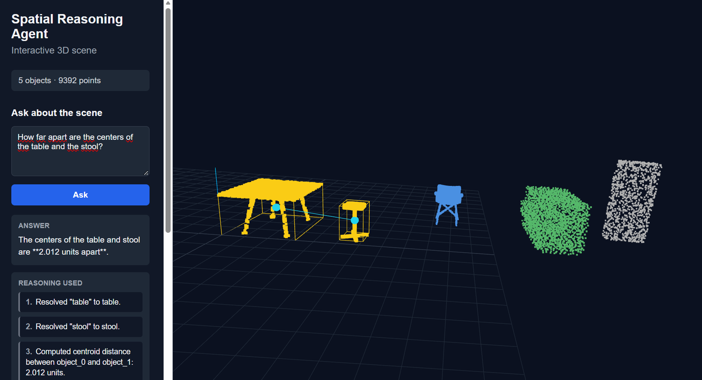
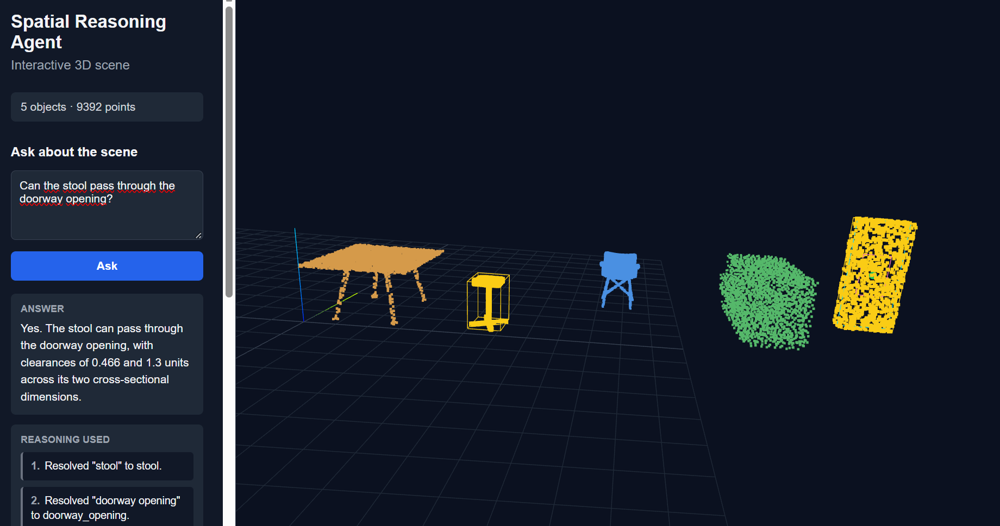

# Spatial Reasoning Agent

An agentic 3D reasoning system that answers natural-language questions about point-cloud scenes by combining semantic object resolution, deterministic geometry tools, scene-graph reasoning, LLM tool selection, and interactive 3D visualization.

The system operates on segmented point-cloud scenes with semantic labels. The language model interprets the user's request and selects geometry tools, while distances, spatial relationships, containment, and passage constraints are computed deterministically in Python rather than estimated directly by the model.

The current version supports both controlled synthetic scenes and more realistic scenes composed from ModelNet40 object point clouds. A FastAPI backend exposes the reasoning system, while a Three.js frontend visualizes the scene, highlights the objects involved in each answer, and displays the geometric operations used by the agent.

---

## Demo

### Centroid Distance



*Centroid-distance reasoning between the table and stool, with the computed measurement visualized in the 3D scene.*

### Doorway Passage



*Doorway-passage reasoning for the stool, with cross-sectional clearance visualized in the 3D scene.*

---

## Features

### 3D Scene Processing

- Point-cloud loading with Open3D

- DBSCAN-based object segmentation

- Raw point storage for browser visualization

- Axis-aligned bounding-box extraction

- Object centroid calculation

- Object dimension calculation

- Bounding-box volume calculation

- Deterministic object IDs

- Semantic object labels

- Support for synthetic and ModelNet40-based scenes

### Geometry Tools

- Centroid distance between objects

- Surface distance between bounding boxes

- Nearest-object search using centroid distance

- Nearest-object search using physical surface separation

- Relative spatial position:
- left / right
- in front / behind
- above / below
- Bounding-box overlap detection

- Radius-based object search

- Largest-object detection

- Object containment checks

- Passage-through-opening checks

### Scene Graph

- Structured spatial relationships between scene objects

- Bidirectional directional relations

- `NEAR` relations based on surface separation

- `OVERLAPS` relationships

- Semantic relation queries

- Multi-relation reasoning

Current relation types include:

```text
LEFT_OF
RIGHT_OF
IN_FRONT_OF
BEHIND
ABOVE
BELOW
NEAR
OVERLAPS
```

### Semantic Reasoning

- Natural-language label normalization

- Mapping semantic names to internal object IDs

- Semantic labels returned alongside object IDs

- Scene-graph relations enriched with semantic labels

The current realistic demo scene contains:

```text
table
stool
chair
cabinet
doorway_opening
```

### Agentic Workflow

- OpenAI Responses API tool calling

- Dynamic geometry-tool selection

- Multi-step tool execution

- Semantic object resolution before geometry operations

- Composition of multiple spatial relations

- Tool-result grounding

- Explicit distinction between centroid distance and physical surface distance

- Explicit distinction between containment and passage through an opening

- Maximum-step termination guard

- Tool failure handling

- Centralized OpenAI client configuration

### Interactive 3D Visualization

The browser frontend uses Three.js and currently includes:

- interactive orbit controls

- point-cloud rendering

- semantic object list

- clickable object selection

- tool-trace-driven object highlighting

- axis-aligned bounding boxes

- centroid-distance visualization

- surface-distance visualization

- doorway-clearance visualization

- human-readable reasoning steps

- expandable raw tool trace

The interface therefore shows not only the final answer, but also which objects and deterministic geometric operations contributed to it.

---

## Technology Stack

Python, FastAPI, Uvicorn, OpenAI Responses API, Open3D, NumPy, H5Py, Pydantic, python-dotenv, pytest, JavaScript, Three.js, and Docker.

---

## Quick Start

### 1. Clone the repository

```bash
git clone https://github.com/palonso-v/spatial-reasoning-agent.git
cd spatial-reasoning-agent
```

### 2. Create a virtual environment

```bash
python -m venv .venv
```

Windows PowerShell:

```powershell
.\.venv\Scripts\Activate.ps1
```

Linux/macOS:

```bash
source .venv/bin/activate
```

### 3. Install dependencies

```bash
pip install -r requirements.txt
```

### 4. Configure environment variables

Create a `.env` file in the repository root:

```text
OPENAI_API_KEY=your_openai_api_key
```

An OpenAI API account with available API credits is required for agent execution and LLM-based evaluation.

The deterministic pytest suite does not require an API key.

---

## Run the Application

The FastAPI backend also serves the frontend, so only one process is required.

Run:

```bash
uvicorn app.api:app --reload
```

Then open:

```text
http://127.0.0.1:8000
```

Available endpoints include:

```text
GET  /health
GET  /scene
GET  /scene/points
POST /ask
```

---

## Docker

Build the application image:

```bash
docker build -t spatial-reasoning-agent .
```

Run the application:

```bash
docker run --rm -p 8000:8000 --env-file .env spatial-reasoning-agent
```

Then open:

```text
http://127.0.0.1:8000
```

Run the deterministic test suite inside Docker:

```bash
docker run --rm spatial-reasoning-agent python -m pytest -q
```

Current result:

```text
12 passed
```

The raw ModelNet40 HDF5 dataset is excluded from the Docker image, while the generated point-cloud scenes required by the application and tests are included.

---

## Realistic ModelNet40 Demo

The main interactive demo uses recognizable object point clouds from ModelNet40 rather than only primitive geometric shapes.

The current scene contains:

```text
table
stool
chair
cabinet
doorway_opening
```

The table, stool, chair, and cabinet are based on ModelNet40 point-cloud samples.

The `doorway_opening` remains a synthetic free-space primitive because the passage tool reasons about the usable opening volume rather than a physical door object.

### Coordinate Conversion

The ModelNet40 objects used by the project are Y-up, while the application uses Z-up coordinates.

The generator applies:

```text
x' = x
y' = -z
z' = y
```

before scaling and placing the objects into the shared scene.

Each object is then:
1. rotated into the common coordinate system
2. centered and normalized
3. uniformly scaled
4. placed on the floor
5. translated into the scene
---

## ModelNet40 Data

The raw ModelNet40 HDF5 files are stored locally and are not committed to the repository.

Expected local structure:

```text
data/
└── ModelNet40/
    ├── train_files.txt
    ├── test_files.txt
    ├── ply_data_train0.h5
    ├── ply_data_train1.h5
    ├── ply_data_train2.h5
    ├── ply_data_train3.h5
    ├── ply_data_train4.h5
    └── ...
```

The folder is excluded through `.gitignore`:

```text
data/ModelNet40/
```

Generate the realistic demo scene with:

```bash
python -m scripts.generate_modelnet_scene
```

Inspect its segmentation with:

```bash
python -m scripts.test_modelnet_scene
```

The current scene is successfully segmented into five intended objects using the same DBSCAN pipeline used by the rest of the system.

---

## Controlled Synthetic Scene

The original synthetic scene remains part of the project because it provides simple, known geometry for development and regression testing.

Generate it with:

```bash
python -m scripts.generate_demo_scene
```

The generated point cloud is stored at:

```text
data/demo_scene.ply
```

Semantic labels are stored in:

```text
data/demo_labels.json
```

The controlled scene contains five semantic objects:

```text
table
box
chair
cabinet
doorway_opening
```

The synthetic and ModelNet40 scenes serve complementary purposes:

- synthetic scenes provide deterministic geometry and known expected answers

- ModelNet40 scenes test the same reasoning pipeline on recognizable object point clouds

---

## Example Spatial Queries

### Relative Position

```text
What is the position of the chair relative to the table?
```

The agent resolves both semantic objects and evaluates their relative spatial position.

### Physical Proximity

```text
Which object is physically closest to the table?
```

The agent uses physical bounding-box separation rather than centroid distance.

### Centroid Distance

```text
How far apart are the centers of the table and the stool?
```

The agent uses centroid distance.

The frontend highlights both objects, displays their bounding boxes, marks their centroids, and draws a line between them.

### Surface Distance

```text
How much empty space separates the table and the stool?
```

The agent uses minimum bounding-box surface separation.

The frontend visualizes the closest points between the two objects.

### Containment

In the controlled synthetic scene:

```text
Can the box fit inside the cabinet?
```

The agent uses:

```text
can_fit_inside
```

The tool compares object dimensions while allowing axis reordering.

### Passage Through an Opening

In the realistic scene:

```text
Can the stool pass through the doorway opening?
```

The agent uses:

```text
can_pass_through_opening
```

rather than the general containment tool.

The passage calculation compares the object's cross-section with the usable opening dimensions.

The frontend visualizes both cross-sections and the resulting pass/fail condition.

A contrasting query is:

```text
Can the cabinet pass through the doorway opening?
```

Different ModelNet40 object instances can produce different passage results across scenes.

---

## Spatial Reasoning Architecture

```text
Natural-Language Question
          |
          v
       LLM Agent
          |
          v
Semantic Object Resolution
          |
          v
 +---------------------------+
 |                           |
 v                           v
Geometry Tools           Scene Graph
 |                           |
 +-------------+-------------+
               |
               v
       Deterministic Results
               |
               v
        Grounded Final Answer
               |
               v
       Visualized Tool Trace
```

The LLM does not estimate geometric quantities directly.

Its responsibilities are:

- interpret the user request

- identify relevant objects

- choose the appropriate geometry tools

- combine intermediate tool results

- generate the final answer

Geometry remains implemented deterministically in Python.

---

## Geometry Layer

The geometry layer currently operates primarily on axis-aligned bounding boxes.

For each object, the scene representation contains:

```text
object ID
semantic label
raw points
centroid
minimum bound
maximum bound
dimensions
point count
volume
```

Conceptually:

```text
SceneObject
 |
 +-- object_id
 +-- label
 +-- points
 +-- centroid
 +-- min_bound
 +-- max_bound
 +-- dimensions
 +-- point_count
 +-- volume
```

The raw point cloud is used for browser visualization.

Centroids and bounding boxes are used by most deterministic spatial tools.

---

## Scene Graph Architecture

```text
3D Scene
   |
   v
Segmented Objects
   |
   v
Centroids + Bounding Boxes
   |
   v
Pairwise Spatial Analysis
   |
   +---------------------+
   |                     |
   v                     v
Directional Relations   Surface Distance
   |                     |
   v                     v
LEFT / RIGHT            NEAR
FRONT / BEHIND
ABOVE / BELOW
   |
   +----------+----------+
              |
              v
          Scene Graph
```

The graph provides a structured representation that can be queried without recomputing every spatial relationship during each agent request.

---

## Semantic Layer

Semantic labels are supplied separately from the point-cloud files and mapped to deterministic object IDs after segmentation.

Example for the realistic demo:

```json
{
  "object_0": "table",
  "object_1": "stool",
  "object_2": "chair",
  "object_3": "cabinet",
  "object_4": "doorway_opening"
}
```

Natural-language labels are normalized before lookup.

For example:

```text
doorway opening
```

can resolve to:

```text
doorway_opening
```

The semantic layer is intentionally simple.

Future versions can replace manually supplied labels with learned 3D semantic segmentation or open-vocabulary scene understanding without changing the deterministic geometry interface.

---

## Evaluation

The project contains several complementary evaluation suites.

### Controlled Spatial Benchmark

The original benchmark contains:

```text
20 questions
```

It evaluates:

- semantic object resolution

- geometry-tool selection

- centroid-distance reasoning

- surface-distance reasoning

- directional relationships

- `NEAR` relationships

- multi-relation reasoning

- object containment

- doorway passage

- overlap detection

- radius queries

- largest-object queries

Run:

```bash
python -m evals.run_agent_eval
```

Current result:

```text
Overall: 20/20
Tool selection: 20/20
Answer checks: 20/20
Average tool calls: 2.65
```

### Paraphrase Robustness Evaluation

Run:

```bash
python -m evals.run_paraphrase_eval
```

Current result:

```text
Overall: 20/20
Tool selection: 20/20
Answer checks: 20/20
Average tool calls: 2.75
```

This benchmark checks whether different phrasings of spatial questions still produce the intended tool selection and answers.

### Synthetic Multi-Scene Evaluation

Run:

```bash
python -m evals.run_multi_scene_eval
```

Current result:

```text
Scene 1: 5/5
Scene 2: 5/5
Scene 3: 5/5

Overall: 15/15
Tool selection: 15/15
Answer checks: 15/15
Average tool calls: 2.33
```

The scenes use different object layouts, so the correct spatial answers change between scenes.

### ModelNet40 Multi-Scene Evaluation

The realistic benchmark uses three composed ModelNet40 scenes.

Each scene uses:

- different ModelNet40 object instances

- different spatial arrangements

- the same DBSCAN segmentation pipeline

- the same semantic and geometry reasoning stack

Generate them with:

```bash
python -m scripts.generate_modelnet_eval_scenes
```

Verify their segmentation with:

```bash
python -m scripts.test_modelnet_eval_scenes
```

Current segmentation result:

```text
Scene 1: 5 objects detected
Scene 2: 5 objects detected
Scene 3: 5 objects detected
```

Run the benchmark:

```bash
python -m evals.run_modelnet_multi_scene_eval
```

Current result:

```text
Scene 1: 5/5
Scene 2: 5/5
Scene 3: 5/5

Overall: 15/15
Tool selection: 15/15
Answer checks: 15/15
```

The benchmark includes largest-object, nearest-object, relative-position, and doorway-passage questions.

Because different ModelNet40 instances have different dimensions, the correct passage result can change between scenes.

The current 15/15 result is a controlled realistic-object benchmark, not a claim of general real-world spatial reasoning accuracy.

### Deterministic Regression Tests

The repository also includes a pytest suite that does not call the LLM.

Run:

```bash
python -m pytest -q
```

Current result:

```text
12 passed
```

The tests cover:

- scene loading

- expected object count

- semantic labels

- raw point storage

- positive object dimensions

- centroid distance

- surface distance

- doorway passage

- scene-dependent passage behavior

- `/health`

- `/scene`

- `/scene/points`

The same deterministic suite also passes inside Docker.

---

## Evaluation Scope

The current results should be interpreted as regression and robustness benchmarks for the current architecture.

They demonstrate consistent behavior across:

- controlled primitive geometry

- paraphrased questions

- multiple synthetic layouts

- multiple ModelNet40 object instances

- multiple ModelNet40 spatial arrangements

They do not establish general 3D spatial-reasoning accuracy.

Important current evaluation limitations include:

- small scenes

- manually supplied semantic labels

- controlled object placement

- axis-aligned geometry approximations

- no learned instance segmentation

- no real reconstructed RGB-D or LiDAR scene benchmark

- no dynamic scenes

- no motion planning

---

## Project Structure

```text
spatial-reasoning-agent/
├── app/
│   ├── init.py
│   ├── agent.py
│   ├── api.py
│   ├── scene.py
│   ├── scene_graph.py
│   ├── schemas.py
│   ├── semantics.py
│   └── tools/
│       ├── init.py
│       └── geometry.py
│
├── shared/
│   ├── init.py
│   └── openai_client.py
│
├── data/
│   ├── demo_labels.json
│   ├── demo_scene.ply
│   ├── modelnet_scene.ply
│   ├── modelnet_scene_labels.json
│   ├── eval_scenes/
│   └── modelnet_eval_scenes/
│
├── evals/
│   ├── init.py
│   ├── spatial_cases.py
│   ├── paraphrase_cases.py
│   ├── multi_scene_cases.py
│   ├── modelnet_multi_scene_cases.py
│   ├── run_agent_eval.py
│   ├── run_paraphrase_eval.py
│   ├── run_multi_scene_eval.py
│   └── run_modelnet_multi_scene_eval.py
│
├── frontend/
│   ├── index.html
│   ├── app.js
│   └── style.css
│
├── scripts/
│   ├── generate_demo_scene.py
│   ├── generate_eval_scenes.py
│   ├── generate_modelnet_scene.py
│   ├── generate_modelnet_eval_scenes.py
│   ├── inspect_modelnet_objects.py
│   ├── test_scene.py
│   ├── test_scene_graph.py
│   ├── test_eval_scenes.py
│   ├── test_modelnet_scene.py
│   └── test_modelnet_eval_scenes.py
│
├── tests/
│   ├── test_api.py
│   ├── test_geometry.py
│   └── test_scene_loading.py
│
├── .dockerignore
├── .gitignore
├── Dockerfile
├── pytest.ini
├── requirements.txt
└── README.md
```

The raw `data/ModelNet40/` dataset is intentionally excluded from the repository.

---

## Design Principles

### Deterministic Geometry

The LLM is not used to estimate distances, dimensions, overlap, containment, or passage constraints.

These operations are performed by deterministic geometry functions.

```text
LLM
 |
 v
Select Tool
 |
 v
Geometry Function
 |
 v
Computed Result
```

This reduces hallucination risk for numerical and geometric quantities.

### Explicit Tool Semantics

Different geometric concepts are handled by separate tools.

For example:

```text
find_nearest_object
-> centroid distance

find_nearest_object_by_surface
-> physical surface separation

can_fit_inside
-> volumetric containment

can_pass_through_opening
-> passage clearance
```

The distinction prevents geometrically different questions from being collapsed into the same operation.

### Semantic Labels Alongside Object IDs

Internal object identifiers such as:

```text
object_1
```

are useful for deterministic processing but are not meaningful to users.

Geometry tools that discover objects therefore return semantic labels alongside internal identifiers where appropriate.

### Structured Scene Representation

Spatial relationships are precomputed into a scene graph.

The agent can query relationships such as:

```text
NEAR(table)
```

or:

```text
IN_FRONT_OF(table)
```

and combine their results.

### Visual Grounding

The frontend uses the tool trace to show which objects and geometric operations were involved in an answer.

This makes the reasoning path inspectable without relying only on the model's generated explanation.

### Evaluation Before Added Complexity

The current implementation deliberately uses a simple tool-calling loop rather than a larger orchestration framework.

More complex orchestration should be introduced only when evaluation shows a concrete need for:

- explicit planning

- verification

- persistent state

- richer execution control

### Synthetic and Realistic Data Serve Different Roles

Synthetic scenes provide exact controlled geometry and known expected answers.

ModelNet40 scenes provide recognizable object point clouds and variation in object shape and dimensions.

Both are retained because they test different parts of the system.

---

## Limitations

This project is currently a research and portfolio prototype.

Current limitations include:

- semantic labels are manually provided

- segmentation uses DBSCAN rather than learned instance segmentation

- geometry reasoning primarily uses axis-aligned bounding boxes

- object orientation is not explicitly modeled using oriented bounding boxes

- containment reasoning uses bounding-box dimensions

- doorway passage assumes a known passage axis

- passage reasoning is not full collision-aware rigid-body motion planning

- ModelNet40 scenes use controlled object placement

- realistic indoor walls and reconstructed environments are not yet included

- real RGB-D or LiDAR scans have not yet been evaluated

- learned semantic segmentation is not implemented

- persistent spatial memory is not implemented

- SLAM is not integrated

- richer scene representations such as Gaussian Splatting are not integrated

---

## Future Improvements

Potential extensions include:

- oriented bounding boxes

- richer geometry beyond AABBs

- learned semantic and instance segmentation

- real reconstructed RGB-D or LiDAR scenes

- noisy and partially observed point clouds

- larger scenes

- dynamic scenes

- explicit planning and verification where useful

- spatial memory

- SLAM integration

- richer 3D scene representations

- embodied-agent style spatial tasks

---

## Long-Term Direction

The long-term goal is to develop the system from a static geometry agent into a broader spatial AI agent.

Potential progression:

```text
Geometry Agent
      |
      v
Semantic Scene Understanding
      |
      v
Scene Graph Reasoning
      |
      v
Spatial Memory
      |
      v
SLAM / Dynamic Mapping
      |
      v
Richer 3D Representations
      |
      v
Embodied Spatial Agent
```

The central design principle remains the same:

```text
LLM -> reasoning and tool selection

3D system -> perception, geometry, and spatial computation
```

---

## Author

Pedro Alonso Vaquero

[GitHub](https://github.com/palonso-v)